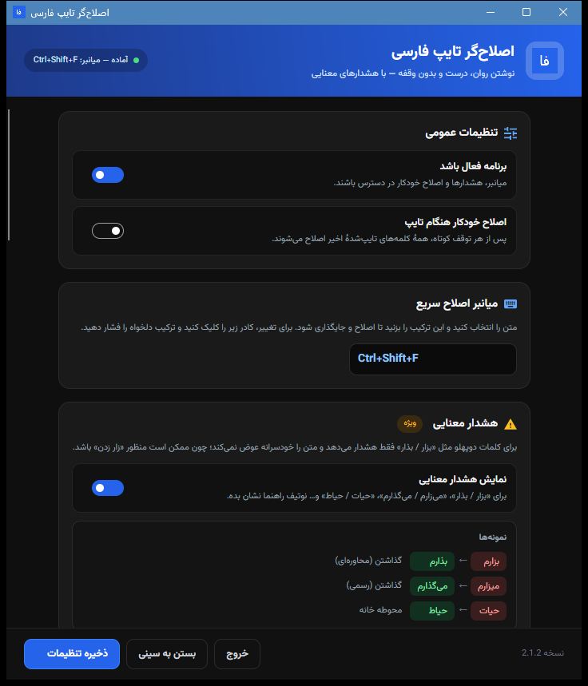
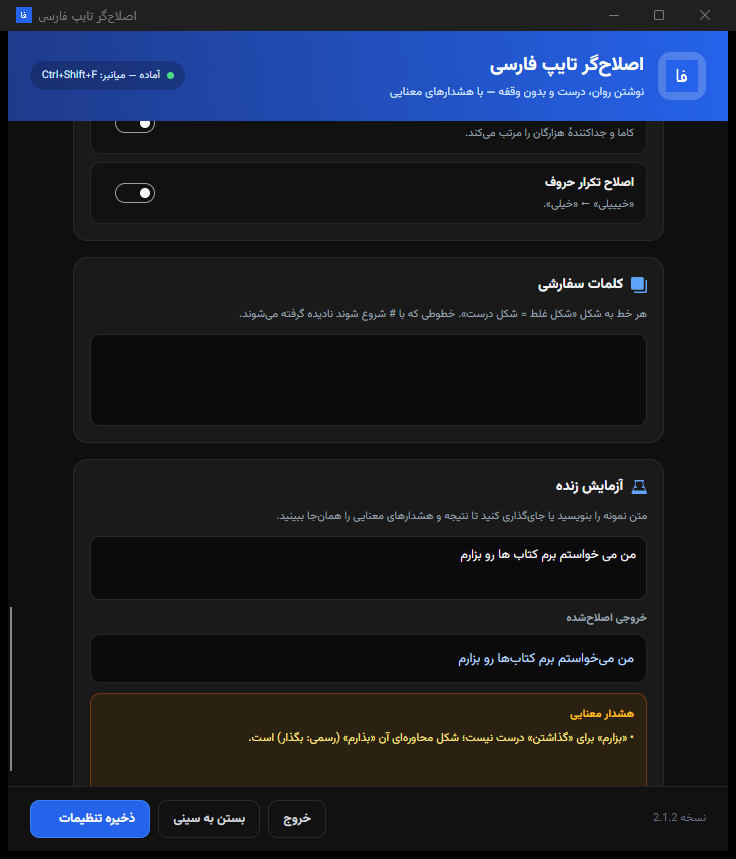
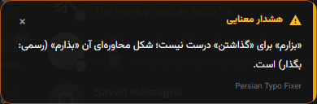

<div align="center" dir="rtl">
  

  <h1>Persian Typo Fixer</h1>

  <p><strong>متن فارسی را همه‌جا درست بنویسید.</strong></p>

  <p>اصلاح خودکار هنگام تایپ در ویندوز و لینوکس (X11؛ Wayland با ydotool)، اصلاح متن انتخاب‌شده، و هشدارهای معنایی — کاملاً آفلاین.</p>

  <p>
    <a href="https://github.com/TheGreatAzizi/Persian-Typo-Desktop/releases/latest/download/Persian.Typo.Fixer.exe"><strong>دریافت نسخهٔ ویندوز</strong></a>
    &nbsp;·&nbsp;
    <a href="https://github.com/TheGreatAzizi/Persian-Typo-Fixer"><strong>افزونهٔ مرورگر</strong></a>
    &nbsp;·&nbsp;
    <a href="https://github.com/TheGreatAzizi/Persian-Typo-Desktop/releases"><strong>همهٔ نسخه‌ها</strong></a>
    &nbsp;·&nbsp;
    <a href="https://github.com/TheGreatAzizi/Persian-Typo-Desktop/issues"><strong>گزارش مشکل</strong></a>
  </p>

  <p>
    <a href="https://github.com/TheGreatAzizi/Persian-Typo-Desktop/releases"></a>
    <a href="https://github.com/TheGreatAzizi/Persian-Typo-Desktop/releases"></a>
    <a href="https://github.com/TheGreatAzizi/Persian-Typo-Fixer"></a>
    
    
    
  </p>
</div>

> [!TIP]
> **فقط داخل مرورگر فارسی تایپ می‌کنید؟**
> لازم نیست نسخهٔ دسکتاپ را نصب کنید. [افزونهٔ Persian Typo Fixer برای مرورگر](https://github.com/TheGreatAzizi/Persian-Typo-Fixer) را نصب کنید تا در چت، ایمیل، فرم و شبکه‌های اجتماعی همان لحظه اصلاح شود. نسخهٔ دسکتاپ برای زمانی است که در Word، تلگرام دسکتاپ، ویرایشگر کد و سایر برنامه‌ها هم فارسی می‌نویسید.

---

<p align="center">
  
</p>
<p align="center"><sub>تنظیمات یکپارچه، با طراحی تیره و رابط راست‌به‌چپ</sub></p>

## چرا Persian Typo Fixer؟

نوشتن فارسی در کامپیوتر پر از جزئیات ریز است: نیم‌فاصله، «ی» و «ک» عربی، فاصله‌های اضافه، اعداد و علائم. وقتی در چند برنامه کار می‌کنید، یکدست نگه‌داشتن متن سخت‌تر هم می‌شود.

Persian Typo Fixer این کار را به یک عادت ساده تبدیل می‌کند: مثل همیشه تایپ کنید؛ برنامه در پس‌زمینه متن را با قواعد آزموده‌شدهٔ افزونهٔ مرورگر اصلاح می‌کند. بدون پنجرهٔ مزاحم، بدون سرویس آنلاین و بدون ارسال متن شما به هیچ سروری.

- **در هر برنامه‌ای:** مرورگر، Word، تلگرام، ویرایشگر کد و هر جایی که متن فارسی می‌نویسید.
- **کاملاً آفلاین:** هیچ متن، آمار یا اطلاعاتی از دستگاه شما خارج نمی‌شود.
- **بدون پیش‌نیاز:** یک فایل اجرایی مستقل؛ نیازی به نصب .NET یا پایتون نیست.
- **مناسب محیط کاری:** پردازش محلی، بدون حساب کاربری و بدون ردیابی.

برای تیم‌ها و سازمان‌هایی که با متن فارسی سر و کار دارند، استقرار محلی و نبود وابستگی ابری یک مزیت واقعی است: داده‌ها روی دستگاه می‌مانند و استفادهٔ تجاری تحت مجوز MIT آزاد است.

## دسکتاپ یا افزونهٔ مرورگر؟

هر دو نسخه بر پایهٔ یک موتور قواعد مشترک ساخته شده‌اند؛ تفاوت در محدودهٔ کار و شیوهٔ نصب است:

| | نسخهٔ دسکتاپ | افزونهٔ مرورگر |
|---|---|---|
| محدوده | همهٔ برنامه‌های ویندوز و لینوکس | فقط داخل مرورگر |
| نصب | فایل اجرایی پرتابل یا AppImage | نصب دستی در Chrome یا Firefox |
| اصلاح هنگام تایپ | بله | بله |
| اصلاح متن انتخاب‌شده | بله، با میانبر یا منوی سینی | بله، با راست‌کلیک یا منوی افزونه |
| میانبر سراسری | ویندوز و X11 | فقط داخل صفحهٔ وب |
| مناسب برای | Word، تلگرام دسکتاپ، ویرایشگر کد، ترمینال و… | چت، ایمیل، فرم، شبکه‌های اجتماعی |
| حریم خصوصی | پردازش محلی | پردازش محلی |

- **اگر بیشتر تایپ شما در مرورگر است،** نسخهٔ دسکتاپ لازم نیست؛ [افزونهٔ مرورگر](https://github.com/TheGreatAzizi/Persian-Typo-Fixer) را نصب کنید. سبک‌تر است و با همان قواعد، متن را داخل فیلدهای وب اصلاح می‌کند.
- **اگر در چند برنامه کار می‌کنید،** نسخهٔ دسکتاپ را انتخاب کنید؛ زیرا در سطح سیستم کار می‌کند و به مرورگر یا برنامهٔ خاصی وابسته نیست.
- نصب هم‌زمان هر دو ممکن است، اما در محیطی که هر دو فعال باشند احتمال اصلاح دوباره یا تداخل وجود دارد. برای هر محیط فقط یکی را فعال نگه دارید.

## امکانات

### اصلاح هوشمند، بدون وقفه

- **اصلاح خودکار هنگام تایپ (ویندوز و لینوکس):** پس از هر توقف کوتاه، همهٔ کلمه‌های تایپ‌شدهٔ اخیر اصلاح می‌شوند؛ نیم‌فاصله، حروف عربی، ترکیب‌های رایج، اعداد و علائم. در X11 بدون تنظیم اضافه فعال است؛ در Wayland نیاز به دسترسی `/dev/input` و `ydotool` دارد (پایین‌تر توضیح داده شده).
- **میانبر سراسری (ویندوز و X11):** متنی را انتخاب کنید و `Ctrl+Shift+F` بزنید؛ نسخهٔ اصلاح‌شده همان‌جا جای متن قبلی می‌نشیند. در Wayland از منوی سینی استفاده کنید؛ با `ydotool` اصلاح‌شده خودکار جای‌گذاری می‌شود، وگرنه متن اصلاح‌شده در کلیپ‌بورد قرار می‌گیرد تا خودتان Paste کنید. میانبر در تنظیمات قابل تغییر است.
- **اصلاح و کپی:** از منوی سینی، متن انتخاب‌شده را اصلاح و در کلیپ‌بورد کپی کنید؛ بدون دست‌زدن به متن اصلی.
- **هشدار معنایی:** برای کلمات دوپهلو مثل «بزار / بذار»، «می‌زارم / می‌گذارم» و «حیات / حیاط» یک نوتیف راهنما نشان می‌دهد و به‌جای تغییر خودسرانه، انتخاب را به شما می‌سپارد.

### کنترل کامل در دست شما

- **رابط فارسی و راست‌به‌چپ:** طراحی تیره با فونت وزیرمتن، خوانا و بدون شلوغی.
- **همهٔ قواعد قابل تنظیم:** هر اصلاح را می‌توانید جداگانه روشن یا خاموش کنید.
- **دیکشنری شخصی:** کلمات خاص خودتان را اضافه کنید؛ هر خط به شکل `غلط = درست`.
- **آزمایش زنده:** متن نمونه را بنویسید و نتیجهٔ اصلاح و هشدارها را همان‌جا ببینید.
- **کنترل از سینی سیستم:** فعال/غیرفعال، اصلاح، اصلاح و کپی، تنظیمات و خروج.

## نحوهٔ کار

1. **شنود محلی کیبورد:** برنامه در ویندوز از هوک کیبورد، در X11 از XRecord و در Wayland از دستگاه‌های `/dev/input` استفاده می‌کند. این مرحله برای تشخیص متن تایپ‌شده، اجرای اصلاح و نمایش هشدارهای معنایی است.
2. **اصلاح پس از توقف کوتاه:** پس از مکث کوتاه، همهٔ کلمات تایپ‌شدهٔ اخیر با قواعد مشترک نسخهٔ مرورگر بررسی می‌شوند؛ نیم‌فاصله، حروف عربی، ترکیب‌های رایج، اعداد و علائم.
3. **جای‌گذاری نتیجه:** برنامه متن قبلی را با Backspace پاک می‌کند و نسخهٔ اصلاح‌شده را جای‌گذاری می‌کند. برای این کار از کلیپ‌بورد موقت و شبیه‌سازی Paste استفاده می‌شود؛ محتوای قبلی کلیپ‌بورد در ویندوز، X11 و Wayland (با `ydotool`) برگردانده می‌شود.
4. **بدون سرور:** هیچ مرحله‌ای به اینترنت، API خارجی یا مدل زبانی آنلاین وابسته نیست. متن نه ذخیره می‌شود و نه ارسال.

> اگر می‌خواهید بدانید چه چیزی اصلاح می‌شود، بخش «امکانات» و «شروع سریع» را ببینید؛ برای بررسی امنیتی، کد `Core` و `Platform` کاملاً باز است.

## پیش‌نمایش

<p align="center">
  
</p>
<p align="center"><sub>آزمایش زنده: نتیجهٔ اصلاح و هشدارها، پیش از ذخیره</sub></p>

<p align="center">
  
</p>
<p align="center"><sub>هشدار معنایی: برنامه تغییر را پیشنهاد می‌دهد و انتخاب را به شما می‌سپارد</sub></p>

پنجرهٔ تنظیمات همهٔ گزینه‌ها را در یک نگاه نشان می‌دهد؛ از قواعد پایه و نشانه‌گذاری تا دیکشنری شخصی و آزمایش زنده. هشدارهای معنایی هم همان‌جا قابل بررسی‌اند.

## دانلود و نصب

آخرین نسخه: **2.2.0** — [تاریخچهٔ نسخه‌ها](https://github.com/TheGreatAzizi/Persian-Typo-Desktop/releases)

### ویندوز 10/11 (64-bit)

1. فایل [Persian.Typo.Fixer.exe](https://github.com/TheGreatAzizi/Persian-Typo-Desktop/releases/latest/download/Persian.Typo.Fixer.exe) را دانلود کنید.
2. آن را اجرا کنید؛ آیکون برنامه در سینی سیستم ظاهر می‌شود.
3. شروع کنید به تایپ.

نسخهٔ ویندوز پرتابل است و نیازی به نصب ندارد. اگر Windows SmartScreen پیام هشدار نشان داد، چون فایل گواهی امضای دیجیتال ندارد، از **More info → Run anyway** استفاده کنید.

### لینوکس (x86_64)

فایل `Persian.Typo.Fixer-*-x86_64.AppImage` را از [صفحهٔ ریلیزها](https://github.com/TheGreatAzizi/Persian-Typo-Desktop/releases/latest) دانلود کنید:

```bash
chmod +x Persian.Typo.Fixer-*-x86_64.AppImage
./Persian.Typo.Fixer-*-x86_64.AppImage
```

اگر AppImage اجرا نشد، `libfuse2` را نصب کنید یا برنامه را با `--appimage-extract-and-run` اجرا کنید.

#### اصلاح خودکار هنگام تایپ در لینوکس

- **X11:** بدون تنظیم اضافه فعال است؛ برنامه با XRecord کلیدها را می‌خواند و با `libXtst` جای‌گذاری می‌کند. برای فعال‌کردن، گزینهٔ «اصلاح خودکار هنگام تایپ» را در تنظیمات روشن کنید.
- **Wayland:** چون Wayland میانبر و شنود سراسری کیبورد را برای برنامه‌های عادی نمی‌دهد، برای اصلاح خودکار به این موارد نیاز است:
  1. نصب `ydotool` و اجرای سرویس `ydotoold` (برای جای‌گذاری کلیدها).
  2. عضویت کاربر در گروه `input` و یک‌بار خروج و ورود دوباره:
     ```bash
     sudo usermod -aG input $USER
     ```
  3. نصب `wl-clipboard` برای خواندن و نوشتن کلیپ‌بورد.

> هشدار امنیتی: عضویت در گروه `input` به برنامه اجازهٔ خواندن همهٔ کلیدهای فشرده‌شده را می‌دهد، حتی وقتی تمرکز روی برنامهٔ دیگری است. این دسترسی فقط برای اصلاح خودکار و هشدار هنگام تایپ لازم است؛ اگر نمی‌خواهید، هر دو گزینه را خاموش بگذارید یا از X11 استفاده کنید.

لی‌اوت کیبورد از `XKB_DEFAULT_LAYOUT`، فایل `~/.config/kxkbrc` (کی‌دی‌ای) یا `/etc/default/keyboard` خوانده می‌شود. اگر لی‌اوت شما شناسایی نشد، مثلاً `XKB_DEFAULT_LAYOUT=ir` را قبل از اجرا تنظیم کنید.

## شروع سریع

1. برنامه را اجرا کنید؛ آیکون در سینی سیستم ظاهر می‌شود.
2. در ویندوز و لینوکس مثل همیشه تایپ کنید؛ اصلاح خودکار پس از توقف کوتاه انجام می‌شود (در Wayland ابتدا پیش‌نیازهای بالا را فراهم کنید).
3. برای اصلاح متن موجود، آن را انتخاب کنید و `Ctrl+Shift+F` بزنید (در Wayland از منوی سینی).
4. برای کپی نسخهٔ اصلاح‌شده بدون جای‌گذاری، از منوی سینی «اصلاح و کپی» را انتخاب کنید.
5. برای تنظیمات، روی آیکون سینی دوبار کلیک کنید یا «تنظیمات…» را بزنید.

> برای باز کردن مستقیم پنجرهٔ تنظیمات: `Persian.Typo.Fixer.exe --settings`

## سازگاری و نیازمندی‌ها

<table dir="rtl">
  <thead>
    <tr>
      <th>قابلیت</th>
      <th>ویندوز</th>
      <th>لینوکس</th>
    </tr>
  </thead>
  <tbody>
    <tr><td>سیستم‌عامل</td><td>Windows 10/11 (64-bit)</td><td>Wayland یا X11 روی x86_64</td></tr>
    <tr><td>اصلاح خودکار هنگام تایپ</td><td>بله</td><td>X11: بله<br>Wayland: با <code>ydotool</code> و دسترسی <code>/dev/input</code></td></tr>
    <tr><td>اصلاح متن انتخاب‌شده</td><td>بله</td><td>X11: خودکار<br>Wayland: خودکار با <code>ydotool</code>، وگرنه کپی در کلیپ‌بورد</td></tr>
    <tr><td>هشدار هنگام تایپ</td><td>بله</td><td>X11: بله<br>Wayland: با دسترسی <code>/dev/input</code></td></tr>
    <tr><td>هشدار برای متن انتخاب‌شده</td><td>بله</td><td>بله</td></tr>
    <tr><td>کلیپ‌بورد</td><td>داخلی</td><td><code>wl-clipboard</code> (Wayland) یا <code>xclip</code>/<code>xsel</code> (X11)</td></tr>
    <tr><td>تزریق کلید</td><td>داخلی</td><td><code>libXtst</code> (X11) یا <code>ydotool</code> (Wayland)</td></tr>
  </tbody>
</table>

- در ویندوز، اصلاح خودکار بر اساس لی‌اوت کیبورد پنجرهٔ فعال کار می‌کند و با چیدمان‌های مختلف سازگار است. در لینوکس X11 نیز لی‌اوت از سرور X خوانده می‌شود؛ در Wayland لی‌اوت از تنظیمات سیستم/کی‌دی‌ای تشخیص داده می‌شود.
- در ویندوز، اگر برنامهٔ مقصد با دسترسی Administrator اجرا شده است، این برنامه را هم با همان دسترسی اجرا کنید.
- در ترمینال‌ها `Ctrl+C` معنای دیگری دارد؛ در این محیط‌ها از اصلاح خودکار یا «اصلاح متن انتخاب‌شده» استفاده کنید.
- میانبر سراسری در لینوکس فقط در X11 کار می‌کند. در Wayland از منوی سینی استفاده کنید؛ با `ydotool` نتیجه خودکار جای‌گذاری می‌شود، وگرنه متن اصلاح‌شده در کلیپ‌بورد قرار می‌گیرد و با Paste خودتان جای‌گذاری می‌شود. برای خواندن انتخاب در Wayland، `wl-clipboard` را نصب کنید.

## محدودیت‌ها و انتظارات واقع‌بینانه

- این ابزار یک **اصلاح‌کنندهٔ قاعده‌محور** است، نه ویراستار هوشمند یا مدل زبانی. غلط‌های نگارشی، جمله‌بندی و انتخاب واژه را به‌طور کامل حل نمی‌کند.
- کلمات دوپهلو (مثل «حیات / حیاط») به‌صورت خودکار تغییر نمی‌کنند؛ برنامه فقط هشدار می‌دهد تا معنی متن خراب نشود.
- در برنامه‌هایی با ورودی سفارشی، بازی‌ها، شبیه‌سازها، ترمینال‌ها یا پنجره‌های امن (مثلاً Run as Administrator) ممکن است شنود یا جای‌گذاری کار نکند.
- در Wayland، این نسخه به دسترسی گروه `input` و `ydotool` نیاز دارد؛ بدون آن، اصلاح خودکار در دسترس نیست. میانبر سراسری هم در Wayland وجود ندارد.
- اگر برنامهٔ مقصد متن را از کلیپ‌بورد نمی‌پذیرد یا Paste را مسدود کرده است، «اصلاح و کپی» مطمئن‌ترین راه است.
- افزونهٔ مرورگر برای صفحات داخلی مرورگر (`chrome://`، `about:` و مشابه) و برخی ویرایشگرهای بوم‌محور اجرا نمی‌شود؛ این محدودیت خود مرورگر است.

## حریم خصوصی

- هیچ حساب کاربری، تبلیغ یا ردیابی‌ای وجود ندارد.
- متن شما به هیچ سروری ارسال نمی‌شود؛ همهٔ پردازش‌ها روی دستگاه شما انجام می‌شود.
- هیچ متن تایپ‌شده‌ای ذخیره نمی‌شود. تنظیمات در این مسیرها نگه‌داری می‌شوند:
  - ویندوز: `%APPDATA%\PersianTypoFixer\config.json`
  - لینوکس: `~/.config/persian-typo-fixer/config.json` (یا `$XDG_CONFIG_HOME`)
- برای جای‌گذاری سریع، برنامه از کلیپ‌بورد استفاده می‌کند؛ در ویندوز و X11 محتوای قبلی را برمی‌گرداند. در Wayland بدون `ydotool` متن اصلاح‌شده برای Paste در دسترس می‌ماند، و با `ydotool` نیز محتوای قبلی کلیپ‌بورد برگردانده می‌شود. در «اصلاح و کپی»، متن اصلاح‌شده طبق خواستهٔ شما در کلیپ‌بورد می‌ماند.

### امنیت و شفافیت

- سورس کامل برنامه، از موتور اصلاح تا هوک‌های سیستم‌عامل، در همین ریپو منتشر شده است؛ می‌توانید کد را بررسی یا خودتان build کنید.
- نسخه‌های رسمی ویندوز و لینوکس توسط GitHub Actions و از همین سورس ساخته می‌شوند.
- برنامه هیچ سرور، حساب کاربری، تلمتری یا کتابخانهٔ تبلیغاتی ندارد. تنها ارتباط شبکه‌ای، دانلود دستی نسخهٔ جدید از GitHub است.
- در Wayland، دسترسی به `/dev/input` یک دسترسی حساس است و باید آگاهانه داده شود. اگر این سطح از دسترسی را نمی‌خواهید، در لینوکس از X11 استفاده کنید؛ و اگر تایپ شما بیشتر در مرورگر است، [افزونهٔ مرورگر](https://github.com/TheGreatAzizi/Persian-Typo-Fixer) گزینهٔ سبک‌تری است.
- گزارش‌های امنیتی را می‌توانید از طریق Issues و بدون قرار دادن اطلاعات حساس ارسال کنید.

## استفاده در تیم‌ها و سازمان‌ها

- **بدون وابستگی ابری:** متن و تنظیمات روی دستگاه کاربر می‌ماند؛ مناسب محیط‌هایی که ارسال متن به سرویس خارجی مجاز نیست.
- **استقرار ساده:** فایل ویندوز پرتابل است و AppImage روی لینوکس اجرا می‌شود؛ نیازی به نصب .NET یا سرور داخلی نیست.
- **تنظیمات مستقل:** هر کاربر می‌تواند قواعد، دیکشنری شخصی و میانبر خودش را داشته باشد.
- **مجوز MIT:** استفادهٔ داخلی، سفارشی‌سازی و توزیع مجدد تحت شرایط MIT آزاد است.
- **ساخت داخلی:** سازمان‌ها می‌توانند با `.NET SDK 8` نسخهٔ self-contained خودشان را بسازند و در کنار سیاست‌های نصب داخلی توزیع کنند.

## پرسش‌های متداول

**آیا برنامه به اینترنت نیاز دارد؟**

نه. فقط برای دانلود نسخهٔ جدید به اینترنت نیاز دارید؛ همهٔ اصلاح‌ها آفلاین انجام می‌شوند.

**آیا متن من جایی ذخیره یا ارسال می‌شود؟**

نه. برنامه هیچ متن تایپ‌شده‌ای را ذخیره نمی‌کند و هیچ داده‌ای ارسال نمی‌کند.

**چطور اصلاح خودکار را در لینوکس فعال کنم؟**

در X11 فقط گزینهٔ «اصلاح خودکار هنگام تایپ» را در تنظیمات روشن کنید. در Wayland علاوه بر آن، `ydotool`/`ydotoold` را نصب و اجرا کنید، کاربر را به گروه `input` اضافه کنید و یک‌بار از حساب خارج و وارد شوید. بدون این پیش‌نیازها، اصلاح خودکار انجام نمی‌شود؛ همچنان می‌توانید از منوی سینی برای اصلاح متن انتخاب‌شده استفاده کنید.

**در Wayland چطور متن را اصلاح کنم؟**

اگر `ydotool` و دسترسی `/dev/input` را تنظیم کرده باشید، اصلاح خودکار و «اصلاح متن انتخاب‌شده» خودکار انجام می‌شود. در غیر این صورت متن را انتخاب کنید و از منوی سینی «اصلاح متن انتخاب‌شده» را بزنید؛ متن اصلاح‌شده در کلیپ‌بورد قرار می‌گیرد و با `Ctrl+V` خودتان جای‌گذاری می‌شود. میانبر سراسری فقط در X11 کار می‌کند و برای خواندن انتخاب در Wayland باید `wl-clipboard` نصب باشد.

**میانبر کار نمی‌کند؛ چه کنم؟**

ممکن است برنامهٔ دیگری از این ترکیب استفاده کند. از تنظیمات، میانبر دیگری انتخاب کنید. در Wayland میانبر سراسری در دسترس نیست؛ از منوی سینی استفاده کنید. اگر برنامهٔ مقصد با Administrator اجرا شده، این برنامه را هم با Administrator اجرا کنید.

**در ترمینال متن اصلاح نمی‌شود.**

در ترمینال‌ها `Ctrl+C` کاربرد دیگری دارد؛ از اصلاح خودکار استفاده کنید یا متن را انتخاب و «اصلاح متن انتخاب‌شده» را از منوی سینی اجرا کنید.

**چطور کلمهٔ دلخواه اضافه کنم؟**

در تنظیمات، بخش «کلمات سفارشی»، هر خط را به شکل `غلط = درست` بنویسید و ذخیره کنید.

**برای مرورگر چه چیزی نصب کنم؟**

اگر بیشتر تایپ فارسی شما در مرورگر است، نسخهٔ دسکتاپ لازم نیست؛ [افزونهٔ Persian Typo Fixer](https://github.com/TheGreatAzizi/Persian-Typo-Fixer) را برای Chrome یا Firefox نصب کنید. افزونه سبک‌تر است و همان قواعد را داخل فیلدهای وب اعمال می‌کند.

**تفاوت با افزونهٔ مرورگر چیست؟**

قواعد اصلاح یکی است، اما دامنهٔ کار متفاوت است: نسخهٔ دسکتاپ در سطح سیستم کار می‌کند و همهٔ برنامه‌ها را پوشش می‌دهد؛ افزونه فقط داخل مرورگر فعال است. اگر فقط در مرورگر کار می‌کنید، [افزونه](https://github.com/TheGreatAzizi/Persian-Typo-Fixer) انتخاب سبک‌تر و ساده‌تری است.

**آیا هر دو را همزمان نصب کنم؟**

فقط اگر واقعاً به هر دو محیط نیاز دارید. اگر هر دو در یک محیط فعال باشند، ممکن است یک متن دو بار اصلاح شود یا جای‌گذاری با تداخل انجام شود. برای هر محیط یکی را فعال نگه دارید.

**آیا از هوش مصنوعی یا اینترنت استفاده می‌شود؟**

نه. اصلاح‌ها با قواعد و دیکشنری محلی انجام می‌شوند و هیچ متنی به مدل یا سرور آنلاین فرستاده نمی‌شود.

**چه چیزهایی را اصلاح نمی‌کند؟**

این برنامه غلط‌های رایج تایپ، نیم‌فاصله، حروف عربی، اعداد و علائم را هدف می‌گیرد؛ ویراستاری کامل، اصلاح جمله و تشخیص مفهوم متن وظیفهٔ آن نیست. برای کلمات دوپهلو فقط هشدار می‌دهد.

**آپدیت چطور انجام می‌شود؟**

نسخهٔ جدید را دانلود و جایگزین کنید؛ تنظیمات شما در پوشهٔ کاربر باقی می‌ماند.

## ساخت از سورس

پیش‌نیاز: .NET SDK 8.

### ویندوز

```powershell
dotnet publish dotnet/src/PersianTypoFixer.App/PersianTypoFixer.App.csproj `
  -c Release -r win-x64 --self-contained true `
  -p:PublishSingleFile=true -p:IncludeNativeLibrariesForSelfExtract=true `
  -p:EnableCompressionInSingleFile=true `
  -o dist/win
```

خروجی: `dist/win/PersianTypoFixer.exe`

### لینوکس

```bash
chmod +x build_appimage.sh
./build_appimage.sh
```

خروجی: `dist/Persian.Typo.Fixer-<version>-x86_64.AppImage`

## تست‌ها

منطق اصلاح متن و هشدارهای معنایی با **۱۷٬۴۶۱ بررسی هم‌ارزی** در برابر نسخهٔ مرجع آزموده می‌شود:

```bash
dotnet run --project dotnet/tests/ParityRunner/ParityRunner.csproj -c Release -- .
```

## ساختار پروژه

- `dotnet/src/PersianTypoFixer.Core` — موتور اصلاح، دیکشنری‌ها، هشدارهای معنایی، هوک‌ها، میانبر و کلیپ‌بورد
- `dotnet/src/PersianTypoFixer.App` — رابط Avalonia، سینی سیستم، پنجرهٔ تنظیمات و نوتیف
- `dotnet/tests/ParityRunner` — تست هم‌ارزی و فایل‌های نمونهٔ مرجع
- `assets/` — آیکون و دارایی‌های تصویری
- `docs/screenshots/` — تصاویر مستندات

## مشارکت و پشتیبانی

- گزارش باگ یا درخواست ویژگی: [Issues](https://github.com/TheGreatAzizi/Persian-Typo-Desktop/issues)
- نسخه‌ها و تغییرات: [Releases](https://github.com/TheGreatAzizi/Persian-Typo-Desktop/releases)
- برای تغییرات بزرگ، پیش از ارسال Pull Request یک Issue باز کنید.
- پیش از ارسال تغییر، تست‌های هم‌ارزی را اجرا کنید.

## حمایت از پروژه

- اگر برنامه به کارتان آمد، به ریپو **ستاره** بدهید تا بیشتر دیده شود.
- آن را به دوستانی معرفی کنید که با متن فارسی کار می‌کنند.
- کلمه یا قاعدهٔ جاافتاده را از طریق [Issues](https://github.com/TheGreatAzizi/Persian-Typo-Desktop/issues) گزارش کنید.
- برای نسخهٔ مرورگر، ستاره و بازخورد در [ریپوی افزونه](https://github.com/TheGreatAzizi/Persian-Typo-Fixer) هم به توسعه کمک می‌کند.

## English summary

Persian Typo Fixer is a free, offline, MIT-licensed desktop application for Windows and Linux that fixes common Persian typing mistakes while you type. It handles Arabic/Persian Yeh and Kaf, ZWNJ (half-space), common compound words, digits and punctuation, and shows non-destructive semantic warnings for ambiguous words. Replacement works system-wide, not only inside a browser, and all processing stays on the device.

- **Desktop app:** download the Windows executable or Linux AppImage from [Releases](https://github.com/TheGreatAzizi/Persian-Typo-Desktop/releases).
- **Browser-only use:** install the lightweight [Persian Typo Fixer browser extension](https://github.com/TheGreatAzizi/Persian-Typo-Fixer) for Chrome or Firefox instead. You do not need the desktop app for browser-only typing.
- **Privacy:** no account, telemetry, cloud API or remote processing. Configuration is stored locally.
- **Building from source:** requires the .NET SDK 8; see the build and test sections above.

## مجوز

این پروژه تحت مجوز [MIT](LICENSE) منتشر شده است؛ استفادهٔ شخصی و تجاری آزاد است.

فونت [وزیرمتن](https://github.com/rastikerdar/vazirmatn) با مجوز SIL OFL 1.1 همراه برنامه ارائه می‌شود. متن مجوز در [`dotnet/src/PersianTypoFixer.App/Assets/Fonts/OFL.txt`](dotnet/src/PersianTypoFixer.App/Assets/Fonts/OFL.txt) قرار دارد.

<div align="center" dir="rtl">
  <sub>Persian Typo Fixer — نوشتن فارسی، بدون دغدغه.</sub>
</div>
